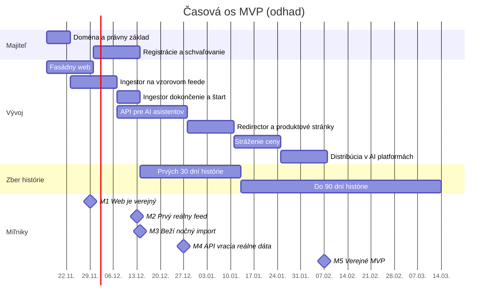

# Plán a stav

Tento dokument hovorí, **kde sme a čo nasleduje**. Čo staviame a prečo, je
v [projekt.md](projekt.md).

Po každom dokončenom kroku alebo novom rozhodnutí sa aktualizuje sekcia
„Kde sme“ a pribudne riadok v denníku.

## Kde sme

_Aktualizované: 2026-11-17_

| | |
| --- | --- |
| **Aktuálna fáza** | Prototyp celého reťazca na vetve `prototyp-api-ingestor` (lokálne, nepushnuté) |
| **Naposledy hotové** | Import feedov, história a štatistiky, falošné zľavy, porovnanie, REST API + OpenAPI, MCP server, redirector, stráženie ceny, neutrálny web, nočný import, ukážka `pnpm demo`. 260 testov. |
| **Rozpracované** | Dokumentácia: výsledky prieskumu (koniec vlastných GPT v ChatGPT 11. 12. 2026, pravidlá katalógov proti reklame) ešte nie sú v `docs/projekt.md`; README nemá návod na spustenie. |
| **Ďalší krok (Claude)** | Dopísať dokumentáciu a prieskum so zdrojmi; potom podľa rozhodnutí majiteľa. |
| **Čaká na majiteľa** | Strategické rozhodnutia: affiliate odkazy vs. zákaz reklamy v katalógoch OpenAI a Anthropic; MCP ako hlavné rozhranie; názov a doména; vizuál; služba na e-maily; zlúčenie vetvy. Pozri aj „Úlohy majiteľa“. |

## Stratégia

1. **Web a registrácie majú prednosť.** Affiliate siete schvaľujú podľa
   existujúceho webu. Bez schválenia nie sú feedy a bez feedov nie je produkt.
2. **Históriu cien začať zbierať čo najskôr.** Je to naša hlavná výhoda a nedá
   sa dobehnúť spätne. Každý deň bez zberu je deň, ktorý bude v priemeroch chýbať.
3. **Vyvíjať paralelne s čakaním.** Kým sa čaká na schválenie, ingestor a API
   vznikajú proti vzorovému feedu, aby boli pripravené v deň prvého reálneho feedu.
4. **Úzky rozsah MVP.** Len elektronika, jedna cesta používateľa: otázka
   v chate → porovnanie → preklik alebo stráženie ceny.
5. **Krok po kroku.** Jedna fáza naraz, po každej kontrola a aktualizácia
   tohto plánu.

## Fázy

Termíny sú odhad pri práci po krokoch. Dĺžku schvaľovania v sieťach nepoznáme
a neovplyvníme ju; všetko po fáze 3 sa posúva podľa nej.

| # | Fáza | Kto | Výstup | Závisí od | Odhad | Stav |
| --- | --- | --- | --- | --- | --- | --- |
| 0 | Základy | Claude | Stack, schéma databázy, dokumentácia | – | 15. 11. | Hotovo |
| 1 | Doména a právny základ | Majiteľ | Doména, DNS na VPS, jasné, na koho sa registrovať | – | 16.–22. 11. | Nezačaté |
| 2 | Fasádny web | Claude, nasadenie majiteľ | Verejný web: úvod, obsah, právne stránky | 1 (pre nasadenie) | 16.–29. 11. | Nezačaté |
| 3 | Registrácie v sieťach | Majiteľ | Schválený účet a prvý reálny feed | 2 | 30. 11. – 13. 12. | Nezačaté |
| 4 | Ingestor a história cien | Claude | Nočný import, párovanie cez EAN, história a štatistiky | Vývoj: 0; ostrý štart: 3 | 23. 11. – 13. 12. | Nezačaté |
| 5 | API pre AI asistentov | Claude | `product-compare` ako REST, OpenAPI a MCP | 4 | 7.–27. 12. | Nezačaté |
| 6 | Redirector a produktové stránky | Claude | Merané prekliky; vyhľadávač a stránka produktu na webe | 5 | 28. 12. – 10. 1. | Nezačaté |
| 7 | Stráženie ceny | Claude | Stránka `/alert`, potvrdzovacie a cenové e-maily | 6 | 11.–24. 1. | Nezačaté |
| 8 | Distribúcia v AI platformách | Claude a majiteľ | Konektor v ChatGPT, Claude a Gemini | 5, 6 | 25. 1. – 7. 2. | Nezačaté |
| 9 | Falošné zľavy a verdikty | Claude | Varovania a verdikty postavené na reálnej histórii | 30 a 90 dní po štarte zberu | od polovice januára | Nezačaté |

## Časová os

## Míľniky

| | Míľnik | Odhad | Čo znamená |
| --- | --- | --- | --- |
| M1 | Web je verejný | 29. 11. 2026 | Dá sa žiadať o schválenie v sieťach. |
| M2 | Prvý reálny feed | 13. 12. 2026 | Prvá sieť nás schválila. Termín je mimo našej kontroly. |
| M3 | Beží nočný import | 14. 12. 2026 | Začína sa zbierať história cien. |
| M4 | API vracia reálne dáta | 27. 12. 2026 | Porovnanie cien funguje, zatiaľ bez histórie. |
| M5 | Verejné MVP | 7. 2. 2027 | Konektor je dostupný v AI platformách. |

Pri štarte MVP bude k dispozícii približne 55 dní histórie. 30-dňový priemer
teda pôjde od začiatku, 90-dňový priemer a verdikty na ňom až okolo polovice
marca 2027.

## Úlohy majiteľa

- [ ] Overiť, či siete vyplácajú provízie fyzickej osobe, alebo treba živnosť či firmu.
- [ ] Overiť pravidlá sietí pre zdroj návštevnosti (odkazy v AI chate).
- [ ] Vybrať názov a kúpiť doménu.
- [ ] Nasmerovať DNS domény na VPS.
- [ ] Rozhodnúť: len Slovensko na začiatok, alebo aj Česko.
- [ ] Rozhodnúť o vizuáli webu (spolu s Claude vo fáze 2).
- [ ] Po spustení webu: registrácia v sieťach (Dognet, eHub) a žiadosti o kampane s elektronikou.
- [ ] Pred fázou 4 naostro: produkčná databáza a zálohy mimo VPS.

## Denník

| Dátum | Čo sa stalo |
| --- | --- |
| 2026-11-15 | Prijaté zadanie. Zvolený stack (TypeScript, PostgreSQL 17, vlastný VPS). Navrhnutá a otestovaná databázová schéma, uložená ako `db/migrations/0001_init.sql`. |
| 2026-11-15 | Zistené, že chýba doména, web aj registrácie v sieťach. Web presunutý pred ingestor. Vznikli `docs/projekt.md` a `docs/plan.md`. |
| 2026-11-17 | Na vetve `prototyp-api-ingestor` vznikol funkčný prototyp všetkých štyroch modulov proti vzorovým feedom (`pnpm demo`). Prieskum: ChatGPT ruší vlastné GPT s Actions (11. 12. 2026, zo sekundárnych zdrojov), náhradou je MCP; katalógy OpenAI a Anthropic zakazujú reklamu a platené umiestnenia, affiliate odkazy výslovne neriešia. E-maily sa zatiaľ len vypisujú do logu. |
