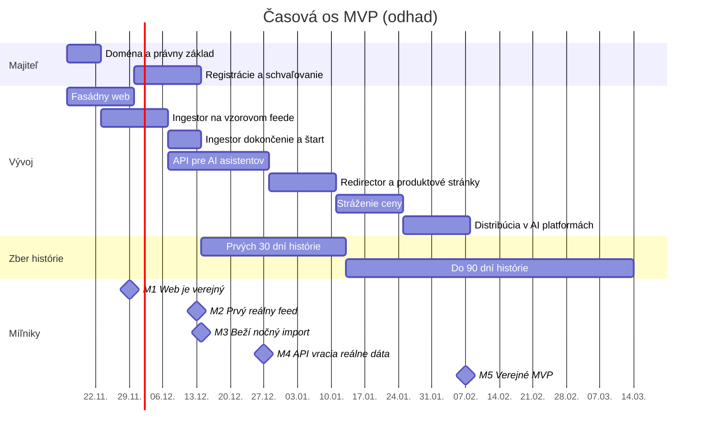

# Plán a stav

Tento dokument hovorí, **kde sme a čo nasleduje**. Čo staviame a prečo, je
v [projekt.md](projekt.md).

Po každom dokončenom kroku alebo novom rozhodnutí sa aktualizuje sekcia
„Kde sme“ a pribudne riadok v denníku.

## Kde sme

_Aktualizované: 2026-11-17_

| | |
| --- | --- |
| **Aktuálna fáza** | Prototyp celého reťazca je hotový, ukážka beží na Verceli s databázou v Neone: <https://porovnavac-cien-nu.vercel.app> (len po prihlásení do Vercelu), 309 testov. Prieskum realizovateľnosti je uzavretý. Web je prerobený na vizuál A „Radar“, vzhľad v prehliadači ešte musí pozrieť majiteľ. |
| **Naposledy hotové** | Web prerobený na vizuál A „Radar“ podľa plánu `docs/superpowers/plans/2026-11-17-vizual-radar.md`: vlastné písma, logo, favicon a obrázok na zdieľanie, rozloženie s mobilným menu bez JavaScriptu, úvodná stránka „Je to naozaj zľava?“, stránka produktu s kartou verdiktu, grafom a ponukami ako kartami, výsledky vyhľadávania ako karty a chyby formulára stráženia priamo pri poli. Gemini z webu zmizol. |
| **Rozpracované** | Kontrola vzhľadu. Claude na VPS nemôže spustiť prehliadač (účet `ai` má zámerne obmedzené práva), vzhľad preto overil len v kóde; na mobile a počítači ho treba pozrieť na Verceli. |
| **Ďalší krok (Claude)** | Opraviť vzhľad podľa pripomienok majiteľa k náhľadu. Služba na e-maily čaká na rozhodnutie 7. Po kúpe domény príprava nasadenia na ňu. |
| **Čaká na majiteľa** | Pozrieť nový vizuál na <https://porovnavac-cien-nu.vercel.app> na mobile aj na počítači a napísať pripomienky. Kúpa domén cenoradar.sk a .cz (odporúčane aj .com), rozhodnutia 5 a 7 až 9 a dve krátke kontroly v ChatGPT. |

## Rozhodnutia majiteľa

Zoradené podľa toho, ako veľmi blokujú ďalšiu prácu. Čísla sa nemenia, aby
platili odkazy na ne. Podklady sú v [prieskum.md](prieskum.md).

1. **Affiliate odkazy voči zákazu reklamy v katalógoch OpenAI a Anthropic.**
   **Rozhodnuté 17. 11.:** priame odkazy ako v prototype. Preklik vedie cez
   náš merací odkaz rovno do obchodu, partnerské odkazy sa priznávajú
   a ponuky sú zoradené len podľa ceny. Pred žiadosťou do katalógu sa
   opýtať podpory OpenAI. Ak žiadosť zamietnu, prejsť na odkazy cez našu
   stránku produktu.
2. **MCP ako hlavné rozhranie.** **Rozhodnuté 17. 11.:** áno, REST API
   ostáva ako druhé rozhranie.
3. **Názov a doména.** **Rozhodnuté 17. 11.:** Cenoradar. Domény
   cenoradar.sk, .cz a .com boli 17. 11. v registroch voľné; kúpu robí
   majiteľ. V [TMview](https://www.tmdn.org/tmview/) nie je ochranná známka
   „Cenoradar“; podobnostné vyhľadávanie našlo len brazílsku „Cenoradas“.
   Kandidáti, z ktorých sa vyberalo:

   | Názov | Význam | .sk | .cz | .com |
   | --- | --- | --- | --- | --- |
   | Cenoradar | sleduje ceny a upozorní na zmenu | voľná | voľná | voľná |
   | Cenostopa | cenová stopa, teda história ceny | voľná | voľná | voľná |
   | Cenopis | kronika cien (ako letopis) | voľná | voľná | voľná |
   | Cenokompas | ukáže, kedy kúpiť | voľná | voľná | voľná |
   | Cenograf | graf ceny | voľná | voľná | obsadená |
   | Cenotrend | vývoj ceny | voľná | voľná | voľná |

   Vyradené: Cenoskop (existujúci český porovnávač nákupných zoznamov),
   Cenomer (oceňovanie nehnuteľností), Cenometer (po česky neprirodzený
   a podobný Cenomeru), Cenopilot (pripomína Microsoft Copilot).
4. **Na koho sa registrovať v sieťach.** **Rozhodnuté 17. 11.:** na fyzickú
   osobu, v sieťach aj pri overení v OpenAI. Plugin sa v katalógu ChatGPT
   zverejní pod menom majiteľa. Majiteľ potvrdil aj povinné údaje na webe:
   zákon o elektronickom obchode (§ 4 ods. 1) vyžaduje od fyzickej osoby
   uviesť meno, adresu bydliska, e-mail a telefón.
5. **Len Slovensko, alebo aj Česko od začiatku.**
6. **Vizuál webu.** Majiteľ 17. 11.: súčasný vizuál je slabý, má byť moderný
   a marketingovo presvedčivý. Claude pripravil tri smery na plátne (odkaz
   v „Kde sme“) a odporúča A „Radar“, lebo z názvu robí obraz a je
   zapamätateľný. Vo všetkých smeroch je rovnaký nový obsah: úvod „Je to
   naozaj zľava?“ s príkladom zdanlivej zľavy, logo, sekcia o použití
   v AI chate, pás so strážením ceny a vysvetlenie, ako zarábame. Otvorené
   je aj to, či pridať na úvodnú stránku sekciu „Ceny, ktoré sa pohli“. Je
   to nová funkcia, ktorá rozširuje rozsah fázy 2.
   **Rozhodnuté 17. 11.:** smer A (majiteľ prijal odporúčanie Claude).
   Sekcia „Ceny, ktoré sa pohli“ sa zapne až s prvým reálnym feedom.
   Návrh je v [projekt.md](projekt.md), kapitola 4. Na webe zavedené
   17. 11. na vetve `prototyp-api-ingestor`.
7. **Služba na e-maily a úložisko záloh mimo VPS.**
8. **Podľa čoho a kedy projekt vyhodnotiť.**
9. **Zlúčiť vetvu `prototyp-api-ingestor` do `main`.** Vetva je na GitHube,
   `main` ostáva v stave z 15. 11. Vercel berie `main` ako produkčnú vetvu,
   takže po zlúčení sa z nej nasadí samo.
10. **Recenzie produktov a hodnotenie obchodov** (nápad majiteľa zo 17. 11.).
    **Rozhodnuté 17. 11.:** do MVP nie, vrátiť sa po spustení, keď budú
    partnerské obchody a návštevnosť. Feedy recenzie neobsahujú; inak by sa
    dali získať len scrapingom alebo dohodou s Heurekou či obchodmi. Zhrnutie
    recenzií z webu robí ChatGPT sám. Podklady sú v [prieskum.md](prieskum.md),
    kapitola 10.

## Stratégia

1. **Web a registrácie majú prednosť.** Affiliate siete schvaľujú podľa
   existujúceho webu. Bez schválenia nie sú feedy a bez feedov nie je produkt.
2. **Históriu cien začať zbierať čo najskôr.** Je to naša hlavná výhoda a nedá
   sa dobehnúť spätne. Každý deň bez zberu je deň, ktorý bude v priemeroch chýbať.
3. **Vyvíjať paralelne s čakaním.** Kým sa čaká na schválenie, ingestor a API
   vznikajú proti vzorovému feedu, aby boli pripravené v deň prvého reálneho feedu.
4. **Úzky rozsah MVP.** Len elektronika, jedna cesta používateľa: otázka
   v chate → porovnanie → preklik alebo stráženie ceny.
5. **Krok po kroku.** Jedna fáza naraz, po každej kontrola a aktualizácia
   tohto plánu.

## Fázy

Termíny sú odhad pri práci po krokoch. Dĺžku schvaľovania v sieťach nepoznáme
a neovplyvníme ju; všetko po fáze 3 sa posúva podľa nej.

Prototyp z 17. 11. predbehol vývojovú časť fáz 4 až 7. Termíny v tabuľke
a na časovej osi sú pôvodný odhad; kritická cesta sa nezmenila a vedie cez
doménu, web a schválenie v sieťach.

| # | Fáza | Kto | Výstup | Závisí od | Odhad | Stav |
| --- | --- | --- | --- | --- | --- | --- |
| 0 | Základy | Claude | Stack, schéma databázy, dokumentácia | – | 15. 11. | Hotovo |
| 1 | Doména a právny základ | Majiteľ | Doména, DNS na VPS, jasné, na koho sa registrovať | – | 16.–22. 11. | Názov a subjekt rozhodnuté; chýba kúpa domény |
| 2 | Fasádny web | Claude, nasadenie majiteľ | Verejný web: úvod, obsah, právne stránky | 1 (pre nasadenie) | 16.–29. 11. | Vizuál A „Radar“ hotový na vetve, vzhľad v prehliadači čaká na kontrolu majiteľa; prevádzkovateľ sa berie z nastavení; v zásadách chýba hosting a služba na e-maily |
| 3 | Registrácie v sieťach | Majiteľ | Schválený účet a prvý reálny feed | 2 | 30. 11. – 13. 12. | Nezačaté |
| 4 | Ingestor a história cien | Claude | Nočný import, párovanie cez EAN, história a štatistiky | Vývoj: 0; ostrý štart: 3 | 23. 11. – 13. 12. | Prototyp hotový; čaká na reálny feed |
| 5 | API pre AI asistentov | Claude | `product-compare` ako MCP, REST a OpenAPI | 4 | 7.–27. 12. | Prototyp hotový |
| 6 | Redirector a produktové stránky | Claude | Merané prekliky; vyhľadávač a stránka produktu na webe | 5 | 28. 12. – 10. 1. | Prototyp hotový |
| 7 | Stráženie ceny | Claude | Stránka `/alert`, potvrdzovacie a cenové e-maily | 6 | 11.–24. 1. | Prototyp hotový; chýba odosielanie e-mailov |
| 8 | Distribúcia v AI platformách | Claude a majiteľ | Plugin v katalógu ChatGPT, konektor pre Claude; Gemini zatiaľ len v USA | 5, 6, reálne feedy | 25. 1. – 7. 2. | Nezačaté; pravidlá a požiadavky zistené |
| 9 | Zdanlivé zľavy a verdikty | Claude | Varovania a verdikty postavené na reálnej histórii | 30 a 90 dní po štarte zberu | od polovice januára | Logika hotová; prahy sa doladia na reálnych dátach |

## Časová os

## Míľniky

| | Míľnik | Odhad | Čo znamená |
| --- | --- | --- | --- |
| M1 | Web je verejný | 29. 11. 2026 | Dá sa žiadať o schválenie v sieťach. |
| M2 | Prvý reálny feed | 13. 12. 2026 | Prvá sieť nás schválila. Termín je mimo našej kontroly. |
| M3 | Beží nočný import | 14. 12. 2026 | Začína sa zbierať história cien. |
| M4 | API vracia reálne dáta | 27. 12. 2026 | Porovnanie cien funguje, zatiaľ bez histórie. |
| M5 | Verejné MVP | 7. 2. 2027 | Konektor je dostupný v AI platformách. |

Pri štarte MVP bude k dispozícii približne 55 dní histórie. 30-dňový priemer
teda pôjde od začiatku, 90-dňový priemer a verdikty na ňom až okolo polovice
marca 2027.

## Úlohy majiteľa

- [x] Založiť hostovanú databázu pre ukážku na Verceli (Neon, 17. 11.).
- [x] Prihlásiť nástroj Vercel na VPS, aby sa dala nastaviť `DATABASE_URL` (17. 11.).
- [ ] V ChatGPT (účet zo Slovenska) pozrieť, či je v bočnom paneli sekcia aplikácií alebo pluginov, či sa v nej dá nájsť napríklad „idealo“ alebo „Slevomat“ a či sa v nastaveniach dá pridať vlastný MCP server. Pár minút; overí, že kanál je dostupný aj zo Slovenska.
- [ ] V ChatGPT vyskúšať Klarna Shopping Search s otázkou na cenu na Slovensku (či Klarna pokrýva SK).
- [x] Rozhodnúť, na koho sa registrovať: fyzická osoba (17. 11.). Dognet vypláca aj fyzickej osobe (minimum 100 €); pri eHub treba overiť.
- [ ] Pri registrácii v Dognete sa písomne opýtať na štyri body z `prieskum.md` (kapitola 6); v eHube na pravidlá pre zdroj návštevnosti.
- [ ] Otvoriť v prehliadači stránku OpenAI o konci vlastných GPT a potvrdiť dátum 11. 12. 2026 (odkaz je v `prieskum.md`).
- [x] Vybrať názov: Cenoradar (17. 11.).
- [ ] Kúpiť domény cenoradar.sk a cenoradar.cz, odporúčane aj cenoradar.com. Čím skôr, voľnú doménu môže ktokoľvek zaregistrovať.
- [ ] Pripraviť údaje prevádzkovateľa: meno, adresa bydliska, e-mail a telefón (stačí samostatné číslo). Pri nasadení ich zapísať do `.env` na serveri (`OPERATOR_NAME`, `OPERATOR_ADDRESS`, `OPERATOR_EMAIL`, `OPERATOR_PHONE`); do repozitára ani do chatu nepatria.
- [ ] Pre zásady ochrany súkromia zistiť poskytovateľa VPS a ako dlho reverzný proxy uchováva logy s IP adresami (alebo IP v logoch skracovať).
- [ ] Nasmerovať DNS domény na VPS.
- [ ] Rozhodnúť: len Slovensko na začiatok, alebo aj Česko.
- [x] Vybrať smer vizuálu webu: A, B, C alebo kombináciu (plátno je v „Kde sme“).
- [ ] Pozrieť nový vizuál na <https://porovnavac-cien-nu.vercel.app> na mobile aj na počítači (úvod, vyhľadávanie, stránka produktu, stráženie ceny) a napísať pripomienky. Claude prehliadač na VPS spustiť nemôže, vzhľad overil len v kóde.
- [ ] Po spustení webu: registrácia v sieťach (Dognet, eHub) a žiadosti o kampane s elektronikou.
- [ ] Pred fázou 4 naostro: produkčná databáza a zálohy mimo VPS.

## Denník

| Dátum | Čo sa stalo |
| --- | --- |
| 2026-11-15 | Prijaté zadanie. Zvolený stack (TypeScript, PostgreSQL 17, vlastný VPS). Navrhnutá a otestovaná databázová schéma, uložená ako `db/migrations/0001_init.sql`. |
| 2026-11-15 | Zistené, že chýba doména, web aj registrácie v sieťach. Web presunutý pred ingestor. Vznikli `docs/projekt.md` a `docs/plan.md`. |
| 2026-11-17 | Na vetve `prototyp-api-ingestor` vznikol funkčný prototyp všetkých štyroch modulov proti vzorovým feedom (`pnpm demo`). Prieskum: ChatGPT ruší vlastné GPT s Actions (11. 12. 2026, zo sekundárnych zdrojov), náhradou je MCP; katalógy OpenAI a Anthropic zakazujú reklamu a platené umiestnenia, affiliate odkazy výslovne neriešia. E-maily sa zatiaľ len vypisujú do logu. |
| 2026-11-17 | Dopísaná dokumentácia: prepísaný `projekt.md`, nové `prieskum.md` (so zdrojmi) a `prevadzka.md`, README. Zmeraný výkon na 100 000 produktoch (`pnpm bench`): import feedu 7–17 s bez nárastu pamäte, porovnanie podľa názvu medián do 100 ms, najpomalší dopyt 435–727 ms. |
| 2026-11-17 | Príprava ukážky na Verceli: vstupný bod `src/index.ts`, naplnenie hostovanej databázy `pnpm demo:seed`, prechod na TypeScript 6 (Vercel so 7 nezostaví). Vetva `prototyp-api-ingestor` pushnutá na GitHub. Chýba hostovaná databáza. |
| 2026-11-17 | Ukážka nasadená na Vercel (projekt `porovnavac-cien`, prepojený s GitHubom, región funkcií Frankfurt, prístup len po prihlásení do Vercelu). Prvé nasadenie padlo pri štarte, lebo preložené súbory odkazovali na moduly s príponou `.ts`; opravené voľbou `rewriteRelativeImportExtensions`. Overené: informačné stránky vracajú 200, API bez databázy 503, neprihlásený návštevník je presmerovaný na prihlásenie. |
| 2026-11-17 | Databáza pre ukážku: projekt v Neone (bezplatný plán, Frankfurt, PostgreSQL 18), prepojený nástrojom `neon` (`neon.ts`, `.env.local`). Migrácie a ukážkové dáta prebehli; `pnpm migrate` a `pnpm demo:seed` používajú priame pripojenie `DATABASE_URL_UNPOOLED`, ak je nastavené. Aplikácia cez pooler overená lokálne. Na Verceli ešte treba nastaviť `DATABASE_URL`. |
| 2026-11-17 | `DATABASE_URL` nastavená na Verceli ako citlivá premenná (Production aj Preview) priamo zo súboru cez nástroj `vercel`; nasadený commit `0c5fba3`. Na Verceli overené: API vracia porovnanie s verdiktom a upozornením na zdanlivú zľavu, stránka produktu má graf ceny, neprihlásený návštevník je presmerovaný na prihlásenie. Na VPS sú prihlásené nástroje `neon` a `vercel` (aktualizovaný na 65.17.0) a nainštalované ich pluginy pre Claude Code. |
| 2026-11-17 | Prieskum realizovateľnosti distribúcie (`prieskum.md`, kapitoly 2, 3, 6 až 8 a 11). V katalógu ChatGPT sú porovnávače idealo a Klarna aj české služby Slevomat a Suri, takže pluginy v EÚ fungujú. Pravidlá OpenAI neprijímajú ukážkové pluginy ani všeobecné názvy. Gemini pripojí vlastný MCP server len v USA. Podmienky Dognetu porovnávač pripúšťajú. Písomne treba potvrdiť AI chat ako zdroj, odovzdávanie údajov z feedov platforme a upozornenia na zdanlivé zľavy. Prekliky neukladajú IP, sieť však áno, a zásady ochrany súkromia to musia uvádzať. |
| 2026-11-17 | Majiteľ rozhodol: priame affiliate odkazy (pred žiadosťou otázka na podporu OpenAI), MCP ako hlavné rozhranie, registrácie na fyzickú osobu. Claude pripravil šesť kandidátov na názov s doménami overenými v registroch .sk, .cz a .com. Zistené: fyzická osoba musí podľa § 4 zákona o elektronickom obchode uviesť na webe adresu bydliska a telefón. |
| 2026-11-17 | Majiteľ vybral názov Cenoradar a potvrdil prevádzku na fyzickú osobu aj s povinnými údajmi na webe. Názov je v kóde aj na webe (predvolený `SITE_NAME`, popis OpenAPI, názov MCP servera, hlavička pri sťahovaní feedov). Domény .sk, .cz a .com overené znova, v TMview nie je zhodná ochranná známka. |
| 2026-11-17 | Údaje prevádzkovateľa podľa § 4 zákona o elektronickom obchode: web ich berie z premenných `OPERATOR_*` (do repozitára nepatria), chýbajúce označí na doplnenie, ako orgán dohľadu uvádza SOI. Zásady ochrany súkromia doplnené o IP adresu a cookies siete pri preklikoch a o technické záznamy servera; ostáva doplniť hosting, službu na e-maily a dobu uchovania logov. Nápad majiteľa na recenzie a hodnotenie obchodov rozobraný v `prieskum.md` (kapitola 10); odporúčanie: do MVP nie. |
| 2026-11-17 | Rozhodnutie 10: recenzie produktov a hodnotenie obchodov do MVP nie, vrátiť sa k nim po spustení. |
| 2026-11-17 | Majiteľ chce modernejší a marketingovo presvedčivejší vizuál. Claude pripravil tri smery ako náhľady úvodnej stránky na počítači a stránky produktu na mobile: A „Radar“ (tmavý úvod s motívom radaru), B „Svieži“ (svetlé farby, nálepkový štýl), C „Nezávislý test“ (redakčný štýl spotrebiteľského testu). Čísla v náhľadoch zodpovedajú logike verdiktu a štatistík nad ukážkovými dátami. |
| 2026-11-17 | Rozhodnutie 6: vizuál A „Radar“, sekcia „Ceny, ktoré sa pohli“ až s reálnym feedom. Návrh zapísaný v `projekt.md`, plán implementácie v `docs/superpowers/plans/2026-11-17-vizual-radar.md`. Hotová úloha 1: písma z vlastného servera (Fontsource 5.3.0, OFL), CSP `font-src 'self'`, `vercel.json` s trvalou vyrovnávacou pamäťou písiem. |
| 2026-11-17 | Web prerobený na vizuál A „Radar“ (úlohy 2 až 7 plánu). Logo, favicon, ikona pre iOS a obrázok na zdieľanie; rozloženie s tmavou hlavičkou a mobilným menu bez JavaScriptu; úvodná stránka s ilustračným príkladom zdanlivej zľavy, sekciou o AI chate (len ChatGPT a Claude), pásom stráženia a blokom „Ako zarábame“. Stránka produktu: karta verdiktu vedie na najlacnejšiu ponuku skladom, dlaždice s priemermi, graf s plochou a viditeľnými cenami (písmo sa na mobile nezmenšuje), ponuky ako karty so štítkom najlepšej. Výsledky vyhľadávania sú karty, chyba formulára stráženia je priamo pri poli. 309 testov. Prehliadač sa na VPS bez rozšírenia práv spustiť nedá, vzhľad preto pozrie majiteľ na Verceli. |
| 2026-11-17 | Nový vizuál nasadený do produkcie Vercelu z vetvy `prototyp-api-ingestor`. Overené: úvodná stránka, stránka produktu s údajmi z Neonu, písmo s trvalou vyrovnávacou pamäťou a obrázok na zdieľanie. Záverečná kontrola celej vetvy (Claude sám, bez druhého posudzovateľa) našla jednu chybu: karta verdiktu písala „Najnižšia cena teraz“, aj keď bola v zozname lacnejšia ponuka mimo skladu; opravené na „Najnižšia cena skladom“. Odložené drobnosti: titulok „ceny od …“ berie najnižšiu cenu skladom, aj keď je v zozname lacnejšia ponuka mimo skladu; zoznamy bez odrážok strácajú v Safari s VoiceOver význam zoznamu; štýly všetkých stránok sú vložené v každej stránke; cesta stráženia na stránke produktu závisí od tvaru `price_alert_url`; vyhľadávanie v hlavičke obsahových stránok hľadá vždy na Slovensku. |
